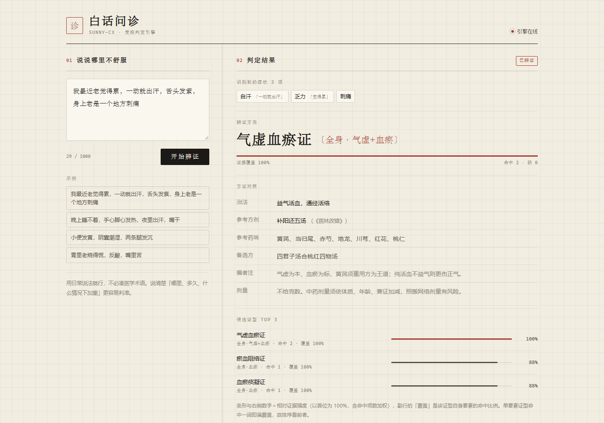
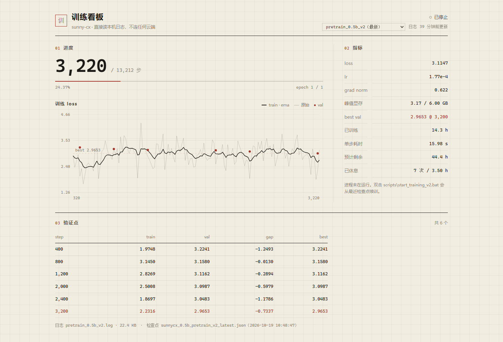

# sunny-cx —— 中医垂域大模型（完全自研训练栈）

> 从零开发大模型 + 开发桌面智能体。

> **训练栈完全自研，不引用任何第三方训练框架的代码**。训练理论依据西瓜书第 5 章。
> 所有命令与路径均相对**仓库根目录**。

## 这是什么

一套从零编写的训练栈，不依赖任何现成大模型框架。参数量 **524,133,504 = 524.13M（≥ 0.5B）**，
在 **GTX 1060 6GB（sm_61）** 上完整跑通预训练与 SFT，并在此之上构建中医白话问诊服务。

## 设计依据分层（关键认知）

| 层次 | 依据 | 内容 |
|---|---|---|
| **训练理论地基** | 周志华《机器学习》(2016) 第 5 章 | BP 误差逆传播、早停法、正则化、梯度下降 |
| **模型架构** | Transformer 论文族 | Attention(2017) / RoPE(2021) / GQA(2023) / SwiGLU(2020) / RMSNorm(2019) |
| **工程增强** | 另据文献 | AMP fp16、8-bit AdamW(2022)、梯度检查点(2016)、序列打包(2021) |

**为什么必须分层**：西瓜书 2016 年 1 月出版，《Attention Is All You Need》2017 年 6 月才发表。
西瓜书第 5 章 5.6 节"深度学习"仅 113–115 页（两三页），
**不含** Attention / Transformer / RMSNorm / RoPE / GQA / SwiGLU。
故架构必须另据论文。地基用西瓜书，上层建筑用 Transformer——这才是"自己从头做"的正确姿势。

## 目录结构

```
sunny-cx/
├── src/sunnycx/
│   ├── config.py      架构配置 + 参数量公式（自校验）+ 预设(0.5b/tiny)
│   ├── model.py       RMSNorm / RoPE / GQA 因果注意力 / SwiGLU / Pre-Norm
│   ├── trainer.py     EarlyStopper(西瓜书5.3) / lr_schedule(5.4) / StaticScaler
│   ├── dataset.py     PackedPretrainDataset(序列打包) / SFTDataset / ValSubset
│   ├── consult.py     受控问诊引擎：规范化→证据→打分→查表→渲染→闸门
│   └── __init__.py
├── server/app.py      FastAPI 服务：/api/consult 等 + 托管 web/
├── web/               前端单页（零依赖 HTML/CSS/JS，宣纸/墨/朱砂）
├── data/consult/      受控词表 + 35 证型方剂表 + 评测集（数据自包含）
├── tests/test_api.py  API 契约测试（stdlib unittest，9 条）
├── scripts/           训练、评测、探针脚本（详见下文）
├── docs/              设计与排障文档（knowledge-assets/ 11 篇）
├── start_web.bat      Windows 一键起服务
├── start_web.sh       macOS / Linux 一键起服务
└── run / configs / checkpoints / logs
```

## 快速开始

### A. 跑起来（白话问诊，CPU 即可，不需要权重）

```bash
pip install -r requirements.txt
python -m uvicorn server.app:app --host 127.0.0.1 --port 8000
# 浏览器打开 http://127.0.0.1:8000
```

Windows 也可直接双击 `start_web.bat`。跑测试：

```bash
python -m unittest discover -s tests -v
```

> 服务只依赖 `data/consult/` 下两张离线表（词表 70 条 / 322 别名，证型 35 条）。
> **不加载大模型**，因此 clone 下来即可运行；模型权重不进仓库（见文末）。

### B. 训练（需要 CUDA 与 torch）

```bash
# 冒烟测试（只校验形状/显存，不训练）
python scripts/train.py --stage pretrain --config 0.5b --dry-run

# 正式预训练（自动从 latest 检查点续训）
scripts/run_pretrain.bat

# 从头训练（忽略已有检查点）
scripts/run_pretrain_fresh.bat

# 或手动：
python -u scripts/train.py --stage pretrain --config 0.5b \
  --batch_size 2 --max_seq_len 512 --accumulation_steps 8 \
  --learning_rate 2e-4 --epochs 1 --gradient_checkpointing \
  --val_interval 400 --val_samples 400 --save_interval 100 \
  --save_weight sunnycx_0.5b_pretrain_v2 --from_weight checkpoints/sunnycx_0.5b_pretrain_warm5600.pth
```

> ⚠ `--val_samples` **不得低于 200**：v1 用 64 条做验证，其中 59% 来自两本书，
> 早停在 step 4600 误触发（大样本口径下 step 5600 更好）。详见下节。

## ⚠️ 长时训练怎么跑（重要）

**由终端或脚本拉起的长时训练，可能在终端关闭、父进程退出时被一并终止**（本项目实测中断两次：
一次停在 step 100，一次只到 step 3）。因此正式训练请**双击**：

```
scripts/start_training_window.bat
```

它会让训练跑在自己的控制台窗口里，完全脱离 agent 会话，并在启动前调用
`guard_single_instance.py` 检查是否已有训练在跑（两个实例会争抢同一块 6GB 显存、
双双 OOM）。

**续训语义**：`run_pretrain.bat` 已带 `--from_resume`，会读取
`checkpoints/sunnycx_0.5b_pretrain_latest.pt`（含 model + optimizer + scaler +
早停状态），从上次的 `epoch/step` 接着跑，**不会重跑已完成的步**。

**存盘策略**：`--save_interval 100`（约每 29 分钟一次），因此意外中断最多损失
100 步；`--val_interval 200` 做真实验证并更新 best。

## 架构（524.13M）

```
hidden_size 1152 / layers 32 / q_heads 12 / kv_heads 4 (GQA) / head_dim 96
intermediate 3648 = ceil(1152·π/64)·64
vocab 6400 (自训中医 BPE) / max_pos 32768 / rope_theta 1e6
Pre-Norm + RMSNorm / SwiGLU / tie_word_embeddings
```

参数量公式（真机校准，误差 **0**）：
```
N = V·d + L·(2d² + 2d·kv·hd + 3d·inter) + d
```

## 白话问诊服务（前端 + 后端）



### 为什么不让模型直接作答

0.5B 在 2,043 本古籍上预训练，**会续写、不保证答对**。让它在自由生成里「辨证 + 开方」，
必然出现三类硬错误：证型乱判、方名臆造（「益气活血通脉汤」）、药味剂量幻觉。
`3.8995` 是**语言建模交叉熵**，与辨证准确率之间没有函数关系——提示词再怎么写也消不掉。

所以把医学结论从生成器手里拿走，改成可查、可校验的七步链路：

```
白话主诉
 → ① 规范化   命中受控词表（70 规范症状 / 322 别名，长别名优先）
 → ② 证据     症状 → (病位, 病性) token 累加权重，单 token 封顶 1.2
 → ③ 打分     35 证型按要素覆盖率排序（病位权重 0.6 < 病性 1.0）
 → ④ 查表     方剂 / 药味 / 出处 直接读 syndrome_table.json，绝不生成
 → ⑤ 渲染     模板槽位全部取自 ③④
 → ⑥ 闸门     证型名 / 方名 / 药味 / 剂量 / 绝对化 / 免责声明 六类校验
 → ⑦ 输出或拒答
```

模型若接入，只允许改写**已通过 ⑥ 的文本措辞**，不得引入任何新的证型名、方名、药味。

### 四种判定（宁可不答，不可错答）

| decision | 触发条件 | 输出 |
|---|---|---|
| `ok` | 覆盖率 ≥ 75% 且前二差距 > 0.04 | 证型 + 治法 + 方剂 + 药味 |
| `differential` | 覆盖率达标但前二差距 ≤ 0.04 | 只给鉴别，不给单选 |
| `weak` | 覆盖率 50%–75% | 只给方向，并列出缺失的辨证要素 |
| `refuse` | 无命中 / 覆盖率 < 50% / 内部校验失败 | **不辨证、不开方**，列出该补充什么 |

拒答时 `candidates` 返回空数组——0 分候选按字母序排名，读者会误以为它被判过。

### API

| 方法 | 路径 | 说明 |
|---|---|---|
| GET | `/api/health` | 存活与引擎规模 |
| GET | `/api/meta` | 阈值、决策说明、免责声明 |
| GET | `/api/syndromes` | 35 证型全表（含方剂、药味、出处） |
| GET | `/api/symptoms` | 受控词表（规范症状 + 别名 + 轴） |
| POST | `/api/consult` | `{text, top_k}` → 结构化判定结果 |
| POST | `/api/check` | 对任意文本做越界校验 |

### 正确性实测（可复现）

```bash
python scripts/selfcheck_consult.py      # 判定准确率 + 闸门 + 表内一致性
python -m unittest discover -s tests -v  # API 契约 9 条
```

| 口径 | 样本 | top-1 | top-3 | **判错且给结论** |
|---|---|---|---|---|
| 调参集 | 18 | 88.9% | 88.9% | **0** |
| **留出集（未参与调词表）** | 12 | **16.7%** | 25.0% | **0** |

88.9% 是**上限不是泛化**——词表就是照着那份集子调出来的；16.7% 才是第一次诚实测量。
失败全部集中在**白话召回**（「手心烦烫」≠「手心发热」、「潮乎乎」≠「阴部潮湿」），
不是判定逻辑错。安全指标（判错且给了结论）两个口径都是 **0**。

另有 8 条错误注入实测（编造方名 / 编造药味 / 编造证型 / 表外真方 / 治法冒充方名 /
剂量 / 绝对化断言 / 缺免责），**8 条全拦、0 漏检**。

> 前端口径提醒：候选条的**条形长度**是相对证据强度（以首位为 100%，含命中项数加权），
> 副行的**覆盖 %** 是该证型自身要素的命中比例。单要素证型命中一词即满覆盖，
> 所以排序看前者——两者不是同一指标，UI 里已标注。

## 训练看板（本地实时）



`/live` 直接读本机 `logs/*.log` 与 `checkpoints/*.json`，
**不查询、不推送任何云端服务**；训练进程停了也能看到最后一次落盘状态。

```bash
python -m uvicorn server.app:app --port 8000
# 浏览器打开 http://127.0.0.1:8000/live
```

- 进度、loss 曲线（原始细线 + EMA 趋势线）、验证点、显存峰值、单步耗时、ETA、休息累计
- 状态按日志新鲜度判定：`training`（5 分钟内有新行）/ `resting`（最后一条事件是休息）/ `stopped`
- ETA 用墙钟 `elapsed` 推算，因此**天然把未来的休息时间算进去**，不是纯算力估算

| 接口 | 说明 |
|---|---|
| `GET /api/train/runs` | 本机可用的训练任务（日志与检查点并集） |
| `GET /api/train/status?run=` | 单任务全量状态；不传 `run` 取最近更新的那个 |

> 日志名与权重名前缀往往不一致（`--save_weight sunnycx_0.5b_pretrain_v2` 配的是
> `logs/pretrain_0.5b_v2.log`）。解析层先试同名，再按词元重合度配对，**重合不足两个词元宁可报 404，也不张冠李戴**。

## 实测成绩（GTX 1060 6GB / sm_61）

| 项 | 结果 |
|---|---|
| 参数量 | 524,133,504（公式 vs 实测差异 **0**） |
| 训练显存峰值 | **3.19 GB / 6.00 GB**（长跑恒定 3.17） |
| 吞吐 | **630 tok/s**（bench 口径；实际训练 15~17 s/step = accum 8 → 8,192 tok/step） |
| 单 epoch（v1 语料 1,018,615 条） | **2.2 天**（打包 11,946 step × 15.6 s）；未打包 11.49 天 → **5.3 倍** |
| loss | 5.2877 @600 → **3.9026 @5600**（26 个验证点，相对 −26.25%；**中途 5 处小幅回升，非单调**） |
| val loss | best **3.8995 @4600** ⚠ 该口径建立在 64 条有偏验证集上；1200 条大样本口径下 latest@5600 实为 **3.4406**（见下） |
| 死参数 | 0（290/290 张量均有梯度） |

> ⚠ **两个已作废的旧数字（易被误引）**：
> ①"单 epoch 1.80 天 / 6.40 倍"来自旧 bench（13.0 s/step），实测口径应为 **2.2 天 / 5.3 倍**；
> ②"loss 8.98→8.15"是早期冒烟数据，正式 26 个验证点的量级是 **5.29→3.90**。

## ⚠️ 早停误触发（v1 停训的真实原因，必读）

v1 在 step 4600 之后触发早停，一度被解读为"预训练到顶"。**实测推翻该结论**：

`ValSubset` 原先硬编码 `if i % 2000 == 0` 抽样，而 val 文件只有 53,705 行 → 只抽到 **27 条**，
其余 37 条由"顺序补齐"从**文件头**抓取。这 64 条里 **59% 来自两本书**
（炙膏肓腧穴法 31% + 疝氣證治論 28%），仅覆盖 25 本书。

| 口径（`scripts/eval_compare.py`） | best@4600 | latest@5600 | 差 |
|---|---|---|---|
| **大样本 1200 条** | 3.5269 (ppl 34.02) | **3.4406 (ppl 31.21)** | **−0.0863 → 5600 更优** |
| 官方 64 条 | 3.8992 | 3.9056 | +0.0064 → **排序相反** |

**已修**：`ValSubset` 步长按 val 文件行数自适应（`_count_lines`），补齐仅作兜底；
正式脚本改为 `--val_samples 400`、`--early_stop_patience 20`。

**纪律**：`val_samples < 200` 时早停结论不可信 —— 64 条约 7.4k token，抽样方差大于真实改进信号。

## 四个 P0 工程要点（6GB 卡训 0.5B 的关键）

详见 `docs/自研栈架构与训练设计.md` 第四节：

1. **权重驻留精度决定 OOM 与否** —— `model.to(device, dtype=torch.float16)`，
   否则 2.10GiB 权重 + 同级梯度 = 4.2GiB，6GB 卡必然 OOM
2. **fp16 权重与 torch GradScaler 不兼容** —— 须自写 `StaticScaler`
3. **fp16 梯度裁剪会静默清零梯度**（最阴险）—— 须在 fp32 下累加范数
4. **序列打包** —— 样本中位仅 60 tok，不打包则 82% 算力浪费在 padding

## 长跑保护：被动熔断 + 主动节律（两个独立机制）

本项目单 epoch 约 2.2 天、2 epoch 合计 4~6 天，长时间连续高负载需要保护。
两者分工明确、互不替代：

| | `thermal.py` 温度熔断（被动） | `rest.py` 节律休息（主动） |
|---|---|---|
| 触发条件 | 温度 ≥82℃ 持续 20s，或驱动热降频 | **连续训练满 2 小时**（与温度无关） |
| 恢复条件 | 降到 ≤74℃ | 休满 **30 分钟** |
| 性质 | 异常兜底（真越界才停） | 节律轮换（到点就休） |
| 实测 | **长跑从未触发**（24.8h 峰值 **81℃**，距 82℃ 仅 1℃） | 每 ~415 步触发一次 |

**两者都在 `optimizer.step()` 之后的干净边界暂停**：梯度已清零、参数已落地，
恢复时直接继续，不需要重放任何一个 step。

关键工程细节（踩坑点）：
- **休息时长必须从训练耗时里扣除**（`t0 += 实际休息秒`），否则 elapsed 虚高、
  ETA 整体偏长，且累计训练时长会把休息算进去 → 触发越来越频繁（正反馈失控）
- **累计状态落盘** `checkpoints/<save_weight>_reststate.json` —— 续训/重启后
  不会"重新获得一个完整 2 小时"，否则反复重启即可绕过保护
- 单次累积增量设上限（`max_tick_sec`），防系统挂起被误算成训练时间

开关与调参：
```
--no_rest                            # 关闭节律休息
--rest_work_hours 2 --rest_minutes 30 # 自定义节律（默认 2h / 30min）
--no_thermal --thermal_pause_c 82 --thermal_resume_c 74   # 温度熔断
```

## 数据账（重要约束）

| 集 | 条数 | tokens |
|---|---|---|
| 预训练 train（v1，已跑 5600 步） | 1,018,615 | 0.945 亿 |
| **预训练 train（v2，重建语料）** | **1,160,348** | **1.0824 亿**（实测 `_count_tokens`） |
| **预训练 val（v2）** | 62,625 | 0.0625 亿 |
| SFT train / val（v2） | 1,081,549 / 62,739 | 均 **92.2 tok/条** |

**Chinchilla 最优数据/参数比 = 20** → 524M 需约 **104.8 亿 tokens**。
当前 1.0824 亿 → 比值约 **2.1**，缺口 **96.8 倍**。

中医古籍物理上限约 4000~5000 种，全数字化仅 **2~3 亿 tokens**。
**结论：纯中医古籍喂不饱 0.5B**。工程已完全跑通，但"能否训好"
取决于是否允许混入通识中文语料（与"只专注中医"定位冲突）。
详见 `docs/knowledge-assets/00-总纲与索引.md`。

## SFT（第二阶段）：长度分桶 + 动态 pad

SFT **不能序列打包**（会串掉多轮对话结构），但**可以分桶**——这是两条不同的加速路径。

SFT 样本长度实测（抽样 3000）：均 **92.2** / P50 77 / P90 159 / P99 249 token。
按单样本补到 512 时 **有效 token 仅 18.3%**，82% 算力在算 padding。

`SFTDataset(dynamic_pad=True)` + `collate_pad` 改为**补到本 batch 最长样本**，
并按 `bucket_chunk` 把长度相近的样本排到一起；pad 位仍是 `label=-100 / mask=0`，
**损失掩码语义与固定 pad 完全一致**（`scripts/verify_sft_bucket.py` 同序逐 token 比对验证）。

```bash
# 校验语义等价 + 量化 padding 节省（纯 CPU）
python scripts/verify_sft_bucket.py

# 真机对比两种 padding 的 s/step 与单轮天数
python scripts/bench_sft_bucket.py --n 32 --accumulation_steps 8 --chunk 512 --stride 1
```

验证集**始终使用固定 pad**——各次 val_loss 必须同口径可比，否则早停判据失真
（v1 就栽在验证集口径上，见"早停误触发"一节）。
## 仓库里有什么 / 没有什么

**有**：训练栈源码、问诊引擎、FastAPI 服务、单页前端、受控词表与 35 证型方剂表、
评测集与自检脚本、11 篇工程文档（每篇按「症状 → 根因 → 修法 → 验证」写）。

**没有**（有意排除，`.gitignore` 已列）：

| 排除项 | 原因 |
|---|---|
| `checkpoints/`、`*.pth` | 单个检查点约 1 GB，且不含在版本库里才有意义的增量 |
| `logs/` | 训练日志逐日膨胀，体积无上限 |
| 语料原文 | 2,043 本古籍的清洗产物约 1.08 亿 token，且涉及源站授权 |
| 本机私有集成 | 训练状态推送模块与本机发布物料，与环境强绑定，不随仓库分发 |

因此 clone 之后**问诊服务可直接跑**（数据自包含），**训练需自备语料与权重**。

## 免责声明

本项目输出的是**中医知识性内容**，不构成诊疗建议，不提供具体剂量，不做疾病诊断。
方剂与药味仅用于说明「某证型在教材中常与某方对应」，任何用药须由执业中医师面诊后决定。
